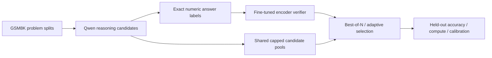
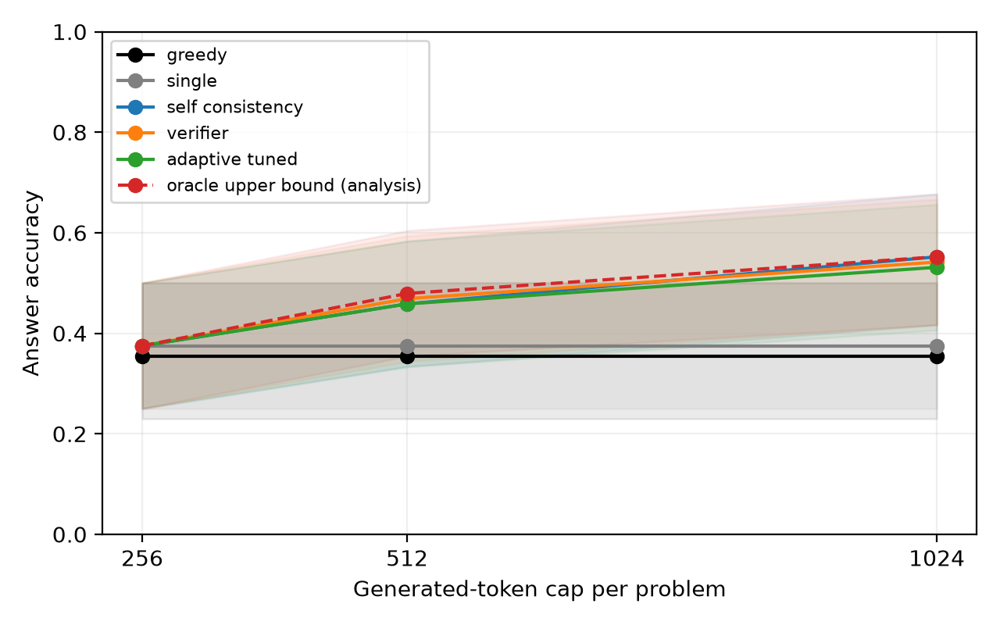

# VeriSearch

[](https://github.com/saidurpulok/verisearch/actions/workflows/ci.yml)

**Can a small learned verifier pick better answers than majority voting when the
token budget is fixed?** I tested this on GSM8K math problems with a 1.5B model,
end to end on an 8 GB laptop GPU.

Short answer: not in this setup. The verifier tied with voting. Its overall
AUROC of 0.96 came mostly from a shortcut it learned, and the shortcut was the
most interesting finding. Adaptive early stopping did help: it used 35% fewer
generated tokens for about one point of accuracy.

## Why I built it

Sampling several solutions and taking a majority vote (self-consistency) is a
strong, cheap baseline for reasoning tasks. A verifier that scores each
candidate should, in principle, do two things better. It should pick the right
answer when the vote gets it wrong, and it should let you stop sampling early
once it's confident. I wanted to see whether either holds up under a hard cap
on generated tokens, on hardware I own, with everything measured rather than
assumed.

## What I built



- **Generator:** [Qwen2.5-Math-1.5B-Instruct](https://huggingface.co/Qwen/Qwen2.5-Math-1.5B-Instruct)
  run locally with Hugging Face Transformers. It samples candidate solutions,
  and every call respects the remaining token budget.
- **Verifier:** [DistilRoBERTa](https://huggingface.co/distilbert/distilroberta-base),
  fully fine-tuned to predict whether a candidate's final answer is correct from
  the question, the extracted answer and the reasoning.
- **Selection policies:**
  - greedy decoding and a single sample
  - majority vote
  - verifier best-of-N
  - adaptive stopping, which stops sampling once the verifier is confident. Its
    threshold is tuned on validation data only and frozen before the test run.
- **Evaluation:**
  - problem-level splits, so no test question leaks into training
  - one shared candidate pool per condition, so every policy chooses from the same samples
  - paired bootstrap confidence intervals and calibration metrics
  - a failure analysis of the cases where the two policies disagree

## What I found

On 48 held-out [GSM8K](https://huggingface.co/datasets/openai/gsm8k) test
problems, averaged over two sampling seeds, at a 1024-token cap:

| Policy | Accuracy | Mean generated tokens |
|---|---:|---:|
| Greedy | 35.4% | 237.9 |
| Majority vote (up to 4 samples) | 55.2% | 953.5 |
| Verifier best-of-N | 54.2% | 953.5 |
| Adaptive early stopping | 53.1% | 617.0 |



- **The verifier didn't beat voting.** At 1024 tokens it was one point behind,
  and at 512 tokens it was one point ahead. Both gaps are within noise at this
  sample size.
- **Adaptive stopping saved tokens.** It used 35.3% fewer generated tokens than
  scoring the full pool, and lost 1.04 points of accuracy.
- **The verifier learned a shortcut.** In the training data, 335 of the 339
  wrong candidates were ones that never reached a final answer. So the verifier
  mostly learned whether an answer was present at all. That alone gives a
  0.96 AUROC overall. Among candidates that did produce an answer, the AUROC was
  0.47, no better than chance (although there were only nine wrong-but-present
  answers in the test set). A high verifier score here doesn't mean the math was
  checked.

The full tables, confidence intervals and failure analysis are in
[RESULTS.md](RESULTS.md). The [calibration](results/pilot/plots/reliability.png),
[adaptive stopping](results/pilot/plots/adaptive_accuracy_vs_tokens.png) and
[other figures](results/pilot/plots/) are in `results/pilot/plots/`, with PDF
versions.

## Limitations

- The test set is small: 48 problems, two sampling seeds and one verifier
  training seed, so the confidence intervals are wide.
- It covers one generator, one dataset and short traces of up to 256 tokens each.
- The token savings count generated tokens only. Verifier scoring, prompt prefill
  and model loading aren't included, so they're not wall-clock speedups.
- Labels check the final answer, not the reasoning, and pretraining
  contamination isn't controlled.

More detail is in [LIMITATIONS.md](docs/LIMITATIONS.md) and
[METHODOLOGY.md](docs/METHODOLOGY.md).

## What I'd try next

- Train the verifier on wrong answers that are present (hard negatives) to
  remove the shortcut.
- Run the full 1,319-problem GSM8K test set.
- Measure end-to-end latency, including the verifier's cost.
- Compare against a step-level (process) verifier.

## Run it yourself

You need Python 3.11–3.13, [uv](https://docs.astral.sh/uv/) and an NVIDIA GPU
for generation and training. The locked Torch build uses CUDA 13.0, and the CPU
tests need neither a GPU nor downloaded models.

```bash
uv sync --frozen --python 3.13
export HF_HOME="$PWD/.cache/huggingface"
uv run python scripts/download_assets.py --config configs/pilot.yaml

uv run verisearch data prepare --config configs/pilot.yaml
uv run verisearch generate --config configs/pilot.yaml --partition fit
uv run verisearch verifier train --config configs/pilot.yaml
uv run verisearch verifier evaluate --config configs/pilot.yaml --split validation
uv run verisearch tune --config configs/pilot.yaml
uv run verisearch generate --config configs/pilot.yaml --partition test
uv run verisearch eval --config configs/pilot.yaml
uv run verisearch plot --results runs/pilot/results.json --output runs/pilot/plots
```

Or run `bash scripts/run_experiment.sh configs/pilot.yaml` to go through
evaluation in one step. Interrupted generation resumes where it stopped. Each new
experiment needs a new output path, because the pipeline won't overwrite
results. `configs/smoke.yaml` is a smaller setup for quick checks, not a benchmark.

The pilot setup was 128 training, 32 validation and 48 test problems, with four
candidates per problem at temperature 0.8. Each trace was capped at 256 new
tokens, with total caps of 256, 512 and 1024 tokens, and the sampling seeds were
17 and 29. Ablations cover candidate count, temperature (0.6 and 1.0),
verifier training-set size (25%, 50% and 100%) and the stopping threshold.

Checks:

```bash
uv run ruff check . && uv run ruff format --check . && uv run mypy src
uv run pytest -m "not gpu and not pretrained and not slow"
VERISEARCH_GPU_TESTS=1 uv run pytest -m gpu   # needs a trained verifier
```

## Repository layout

- `src/verisearch/data`: loading GSM8K and making problem-level splits
- `src/verisearch/generation`: seeded local generation and numeric answer extraction
- `src/verisearch/verifier`: the verifier's inputs, training and scoring
- `src/verisearch/policies`: voting, ranking and adaptive stopping
- `src/verisearch/evaluation`: metrics, bootstrap intervals, error reports and plots
- `experiment.py`, `cli.py`: the staged pipeline and the command-line tool
- `results/pilot/`: the measured results, plots and checksums from the pilot run
- [Architecture](docs/ARCHITECTURE.md), [code guide](docs/CODE_GUIDE.md) and
  [validation record](docs/VALIDATION.md)

## References

This project builds on [GSM8K](https://arxiv.org/abs/2110.14168),
[self-consistency](https://arxiv.org/abs/2203.11171) and
[Qwen2.5-Math](https://arxiv.org/abs/2409.12122).

The code is under the MIT license. The dataset and model licenses stay with their
publishers.
