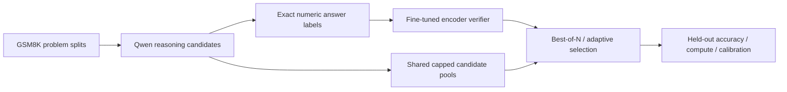

# VeriSearch

[](https://github.com/saidurpulok/verisearch/actions/workflows/ci.yml)

**Verifier-Guided Reasoning Under Fixed Inference Budgets**

VeriSearch is a local research implementation studying whether a learned outcome
verifier can improve math answer selection over greedy decoding, sampling and
self-consistency under generated-token caps. It is designed for an 8 GB laptop GPU
and uses public models without paid APIs. v0.1 is a small empirical pilot,
not a claim of algorithmic novelty.

## Pilot results

The pilot was evaluated on an NVIDIA RTX 5070 Laptop GPU. At the 1024-token cap,
on 48 official-test problems and two sampling seeds:

| Policy | Accuracy | Mean generated tokens |
|---|---:|---:|
| Greedy | 35.4% | 237.9 |
| Self-consistency (up to 4) | 55.2% | 953.5 |
| Learned verifier best-of-N | 54.2% | 953.5 |
| Validation-tuned adaptive | 53.1% | 617.0 |

The verifier did not consistently outperform voting. Adaptive replay consumed
35.3% fewer generated tokens than full reranking with 1.04 percentage points less
accuracy. The 48-problem pilot has wide confidence intervals and makes no
significance or end-to-end speedup claim.

Overall verifier AUROC was 0.9605, but AUROC **among extracted answers** was
0.4695. Classification accuracy matched a trivial answer-presence classifier.
These measurements do not establish mathematical verification.

See [RESULTS.md](RESULTS.md), [validation evidence](docs/VALIDATION.md), and
[tracked artifacts](results/README.md) for actual
measurements and validation evidence. The central figures are
answer accuracy vs token cap, accuracy vs candidate count, calibration,
correct/incorrect score distributions and adaptive accuracy vs consumed tokens.
Full traces and model checkpoints remain in ignored `runs/`; small summaries,
manifests, plots and selected failure examples are versioned.

The fit data is dominated by missing final answers (335 of 339 training negatives;
all 75 validation negatives). The result report includes an answer-presence
shortcut diagnostic; high verifier classification scores must not be read as
proof of mathematical checking.

This pilot cannot establish benchmark-wide improvements. It uses a small
generator, small verifier dataset and short traces; exact-answer labels do not
prove reasoning correctness. Pretraining contamination is not controlled.
Verifier shortcuts, distribution shift, laptop latency variability and excluded
scoring costs are material limitations. Read [LIMITATIONS](docs/LIMITATIONS.md).


The dashed oracle curve is an analysis-only upper bound.
[Adaptive stopping](results/pilot/plots/adaptive_accuracy_vs_tokens.png),
[calibration](results/pilot/plots/reliability.png), and
[all figures](results/pilot/plots/) are available with PDF exports.

## Research pipeline



The generator is [Qwen2.5-Math-1.5B-Instruct](https://huggingface.co/Qwen/Qwen2.5-Math-1.5B-Instruct)
through Hugging Face Transformers. The outcome verifier is
[DistilRoBERTa](https://huggingface.co/distilbert/distilroberta-base), fully fine-tuned
on question, extracted candidate answer and reasoning. It predicts **answer
correctness**, not the validity of each reasoning step.
[Official GSM8K](https://huggingface.co/datasets/openai/gsm8k) training problems
supply disjoint verifier train/validation subsets; official test problems are
reserved for final reporting. Revision hashes and question IDs are recorded.

Implemented methods are greedy, one stochastic sample, majority-vote
self-consistency, learned-verifier best-of-N, and sequential verifier-guided
early stopping. Oracle any-correct selection is an analysis-only upper bound.
Voting ignores missing answers; ties and verifier score ties prefer the earliest
candidate. Adaptive stopping uses a threshold selected only on validation data;
disabled stopping uses the entire available pool. Test gold never enters a
generator, scorer input or deployable selector.

Each generation call respects the remaining token budget. Comparable stochastic
policies reuse the same capped pool. Encoder scoring, prompt prefill and model
loading are excluded from the generated-token cap and must be considered when
interpreting compute efficiency. Adaptive sweeps replay prefixes; the selector
also supports a live lazy generator.

## Setup

Python 3.11–3.13 and [uv](https://docs.astral.sh/uv/) are required. On WSL, install
a current Windows NVIDIA driver supporting the GPU; the locked Torch wheel uses
CUDA 13.0. No separately installed CUDA toolkit is required for these wheels.
The environment/model cache uses several GB of disk. CPU unit tests require no
downloaded models or accessible GPU; generation/training configs explicitly
request CUDA and fail if unavailable rather than silently changing hardware.

```bash
uv sync --frozen --python 3.13
export HF_HOME="$PWD/.cache/huggingface"
export MPLCONFIGDIR="$PWD/.cache/matplotlib"
export UV_CACHE_DIR="$HOME/.cache/uv"
uv run python scripts/download_assets.py --config configs/pilot.yaml
```

The download helper preserves pinned revisions, resolves any `main` reference,
and refuses to alter a config after data preparation. The committed pilot config
has immutable revisions. A fresh experiment needs a new `output` path; the
pipeline refuses destructive overwrites. Commands assume the repository root.

## Reproduce the pilot

```bash
uv run verisearch data prepare --config configs/pilot.yaml
uv run verisearch generate --config configs/pilot.yaml --partition fit
uv run verisearch verifier train --config configs/pilot.yaml
uv run verisearch verifier evaluate --config configs/pilot.yaml --split validation
uv run verisearch tune --config configs/pilot.yaml
uv run verisearch generate --config configs/pilot.yaml --partition test
uv run verisearch eval --config configs/pilot.yaml
uv run verisearch plot --results runs/pilot/results.json --output runs/pilot/plots
```

Alternatively run `bash scripts/run_experiment.sh configs/pilot.yaml` for the
stages through evaluation. Reissuing an interrupted generation command resumes
from atomically stored completed pools. Verifier training skips completed fraction
checkpoints. Data preparation and frozen tuning are one-time stages.

Pilot: 128 training / 32 validation / 48 test problems; four candidates at
temperature 0.8; 256 new tokens per trace; 256/512/1024 token caps; generation
seeds 17/29. Required ablations cover candidate count, temperatures 0.6/1.0,
nested 25/50/100% training-problem subsets, and stopping thresholds. The temperature
ablation is first-seed-only; compare with the matching first-seed 0.8 result.
`configs/smoke.yaml` is a smaller diagnostic setup, not a benchmark; training
deliberately refuses single-class data and may require a larger smoke sample.

## Checks

```bash
uv run ruff check .
uv run ruff format --check .
uv run mypy src
uv run pytest -m "not gpu and not pretrained and not slow"
VERISEARCH_GPU_TESTS=1 uv run pytest -m gpu
```

The real GPU test additionally needs a trained verifier at the configured output.
CPU tests cover exact extraction, query-level leakage, serialization, voting ties,
gold-free ranking, lazy stopping, hard token caps, metrics, cluster bootstrap,
frozen configs, CLI and error reporting. Markers distinguish real pretrained
GPU integration from CPU correctness tests.

## Repository map

- `src/verisearch/data`: schemas, official loading and query-level splits.
- `generation`: local generation, seeded decoding and conservative numeric parsing.
- `verifier`: label-safe input, nested subsets, training and probability scoring.
- `policies`: greedy/single, voting, ranking and lazy adaptive selection.
- `evaluation`: metrics, problem bootstrap, error reports and exportable plots.
- `experiment.py` and `cli.py`: saved-config, gated research workflow.
- `configs/`, `tests/`, `results/`: experiment definitions, correctness evidence,
  small measured artifacts.
- [Architecture](docs/ARCHITECTURE.md), [Methodology](docs/METHODOLOGY.md),
  [Code guide](docs/CODE_GUIDE.md).

## Sources
The project builds on [GSM8K](https://arxiv.org/abs/2110.14168),
[self-consistency](https://arxiv.org/abs/2203.11171), and
[Qwen2.5-Math](https://arxiv.org/abs/2409.12122).
No result from those works is presented as a VeriSearch measurement.
Code: MIT license. Dataset/model licenses remain with their original publishers.
