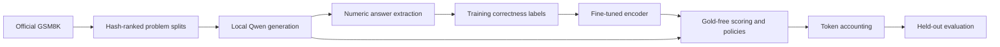

# Architecture

A `Problem` contains a `Query` and gold numeric answer. A `Candidate`
contains only generated information; a `LabeledCandidate` adds the gold answer
and exact-answer label. Generation receives only `Query`; selection receives
only `Candidate` and a callable learned scorer. Labels are attached to policy
outcomes afterwards. See [schema](../src/verisearch/data/schema.py),
[split](../src/verisearch/data/split.py), and
[selection](../src/verisearch/policies/selection.py).

The mathematical mechanism is intentionally small. Transformers generates each
trace autoregressively. A pretrained encoder is fully fine-tuned with binary
cross-entropy (two-class softmax cross-entropy) on serialized question, extracted
answer and trace. Inference maps logits to the probability of answer correctness.
It is an **outcome verifier**, not a proof checker or a process reward model.

[Training](../src/verisearch/verifier/train.py) uses AdamW, shuffled batches,
gradient clipping, and minimum validation-loss checkpoint selection. Fractions
are nested subsets of entire training problems. The input places the candidate
answer before reasoning so truncation preferentially retains it; lengthy inputs
can lose late reasoning. Truncation rates are recorded.

[Generation](../src/verisearch/generation/generator.py) uses one GPU-resident
generator, BF16 weights on CUDA, SDPA, batch size one. The model is not fine-tuned.
Generator and verifier are loaded in separate stages to reduce peak VRAM.
Verifier fine-tuning uses FP32; no quantization or paid APIs are involved.

Each completed trace costs its actual generated token IDs, including emitted EOS.
Each new call is capped at min(remaining budget, per-trace limit). Each budget gets
its own actual candidate pools: a final trace can be truncated by remaining budget.
Dropping long traces from an unconstrained pool would be an unfair comparison.
Prompts, encoder tokens, loading and scoring are separate costs and excluded from
the generated-token cap. This is not a total-FLOPs cap.

Adaptive selection accepts a lazy iterator. It stops requesting candidates on
confidence, candidate count or token cap. The empirical sweep replays prefixes of
previously generated capped pools. With identical seeds and per-call caps this
preserves the selection/tokens of sequential execution; it does not demonstrate
an end-to-end deployment speedup. A real lazy-generation path exists in the same
selector and is tested.

[Experiment stages](../src/verisearch/experiment.py) persist prepared manifests,
training pools, checkpoints, frozen validation tuning, test pools, decisions,
summaries and failure reports. Each completed pool is atomically checkpointed for
resume. Data and config cannot be overwritten in place. Model caches and full
traces stay out of Git; small summaries, manifests and selected error examples
are intentionally tracked.
